# Saturn's Rings

The ring picture is a function of one number, the angle at which we look at the ring plane. Everything else is geometry in the screen frame of the planet.

## 1. The ring plane is Saturn's equator

The rings lie in Saturn's equatorial plane, so the plane is fixed by Saturn's north pole. The app uses the IAU 2015 WGCCRE pole at J2000: **RA 40.589°, Dec 83.537°**. Its slow drift (about 0.04° a century) is ignored. As an ICRS unit vector:

```
p = (cos δ cos α,  cos δ sin α,  sin δ)     with α = 40.589°, δ = 83.537°
  = (0.0856, 0.0733, 0.9936)               (numerically: 0.11262 × 0.75975, 0.11262 × 0.65204, 0.99364)
```

## 2. A local frame at the planet

At the planet's direction `d` (unit vector from us to Saturn), take the camera's `right` and `up` vectors and project them onto the plane perpendicular to `d`:

```
e1 = normalize(right - (right·d) d)
e2 = normalize(up    - (up·d)    d)
e3 = e1 × e2                           points towards the viewer
```

Express the pole in this frame: `(p·e1, p·e2, p·e3)`. Because it uses the camera's own right and up, the rings come out right whatever the camera roll.

## 3. Ring tilt `B` for an observer on Earth

Let `d` be the unit vector from us to Saturn (ICRS), and `p` the ring-plane normal (Saturn's north pole) from section 1. The ring plane is the set of directions perpendicular to `p`. The angle between our line of sight and that plane is `B`, the *sub-Earth latitude on the ring plane*:

```
sin B = -(p · d)
```

In the local frame of section 2 the axis `e3` points towards the viewer, `e3 = -d`, so this is simply the z component of the pole there: `sin B = p · e3`. That is the number the renderer hands to the shader.

The minus sign is there because `d` points *from* us *to* Saturn: the north face of the rings is the one we see when the pole `p` points back towards us, that is when `p · d < 0`, which gives `B > 0`. So:

- `B > 0`: we look at the **north face** of the rings. `B < 0`: the **south face**. `B = 0`: edge-on, a *ring-plane crossing*.
- `|B|` can reach about 27°: Saturn's axial tilt is 26.73° and the Earth sits within a few degrees of Saturn's orbital plane.
- `B` changes slowly over Saturn's 29.5-year orbit (north face towards us, then edge-on, then the south face, and back) and wobbles a little each year, because we move around the Sun while looking at Saturn.

The ring circle seen at that angle becomes an ellipse with

```
minor / major axis ratio = |sin B|
```

and the major axis is perpendicular to the on-sky direction of the pole (section 5).



### Why the formula is that

Take axes where the ring plane is the floor. A ring particle at radius `R` has coordinates `(R cos u, R sin u, 0)`. Look at the floor from a height angle `B` above it: the width across the line of sight stays `R cos u`, but the depth along our line of sight is foreshortened by `sin B`, giving `R sin u sin B`. That is an ellipse with semi-axes `R` and `R sin B`. The height angle of the line of sight above the floor is, by definition, the angle between `-d` and the floor, and `sin` of it is `-d · p` since `p` is the floor's normal. (An orthographic view, see [Projections](Projections.md), is what makes this exact: the planet is so far away that all view rays are parallel.)

### Worked example: 2026-10-24 (JD 2 461 337.5)

The app's low-precision planet tier puts Saturn at RA 9.77°, Dec +1.27° on that date:

```
d = (cos δ cos α, cos δ sin α, sin δ) = (0.98526, 0.16960, 0.02219)
p = (0.08548, 0.07324, 0.99364)                        (section 1)
p · d = 0.08548×0.98526 + 0.07324×0.16960 + 0.99364×0.02219 = 0.11869
sin B = -0.11869        B = -6.82°        axis ratio = 0.119
```

So the **south face** of the rings is toward us, tilted 6.8°, and the ellipse is about 12% as tall as it is wide. (The info card prints this as "Ring tilt 6.8° (south face, ...)".)

### How the app checks itself

- Meeus, *Astronomical Algorithms*, example 45.a: 1992-12-16 gives `B = 16.442°`, `P = 6.741°`. The app gets 16.473° and 6.691°.
- The 2017 maximum (about 26.9°) and the ring-plane crossing of March 2025 (0.03° on 2025-03-23).
- The renderer builds the ring ellipse from the same pole constants; a test compares the `sin B` it draws with the ephemeris function at four dates.

### Opening or closing

The info card also says whether the rings are *opening* (`|B|` growing) or *closing*. The app compares `|B|` ten days before and ten days after. That is the tilt's trend right now, which follows both Saturn's long orbit and our own yearly motion, so near opposition it can briefly differ from the multi-year trend.

### The same angle from ecliptic coordinates

Almanacs give `B` from Saturn's ecliptic longitude `λ` and latitude `β` and the ring plane's inclination `I = 28.07°` and ascending node `Ω = 169.51°` to the ecliptic:

```
sin B = sin I cos β sin(λ - Ω) - cos I sin β
```

(The sign follows the same convention as above: positive when the north face is seen.) It is the same dot product written in ecliptic axes; the app uses the equatorial form because the renderer already works in ICRS.

## 4. Position angle of the rings on the sky

The ellipse is tilted on the sky. The **position angle** `P` of the ring's north pole is measured from celestial north through east:

```
north = normalize( z - (z·d) d )          z = (0, 0, 1)
east  = normalize( z × d )
p⊥    = p - (p·d) d                       the pole projected on the sky
P     = atan2( p⊥ · east,  p⊥ · north )
```

For 2026-10-24: `p⊥ · north = 0.9913`, `p⊥ · east = 0.0577`, `P = atan2(0.0577, 0.9913) = 3.33°`. The ring's minor axis points almost straight up (towards celestial north), tipped 3.3° towards the east. The ellipse's major axis is perpendicular to it. `|p⊥| = 0.993 = cos B`, which is why the ring ellipse flattens as `B` shrinks.

## 5. Per-pixel ring radius

The shader works one pixel at a time. A pixel at screen offset `(x, y)`, in Saturn radii from the centre (1 radius = 60 268 km), corresponds to a view ray `(x, y, t)` in the local frame, where `t` is the unknown depth. The ray meets the ring plane where `p · (x, y, t) = 0`, with the pole's local components `(p_x, p_y, p_z)`:

```
p_x x + p_y y + p_z t = 0       ⇒   t = -(p_x x + p_y y) / p_z
ρ = sqrt(x² + y² + t²)          ring radius, in Saturn radii
```

(If `p_z` is almost 0 the rings are edge on and the ray never meets the plane; the shader handles that case separately.)

## 6. Ring structure

| Feature | Inner → outer radius (Saturn radii) | Opacity (about) |
|---|---|---|
| C ring | 1.24 → 1.53 | 0.22 |
| B ring | 1.53 → 1.95 | 0.88 |
| Cassini division | 1.95 → 2.03 | 0.04 |
| A ring | 2.03 → 2.27 | 0.62 |
| Encke gap (in the A ring) | 2.205 → 2.225 | gap |

A pixel's ring opacity is looked up from `ρ`.

## 7. Occlusion and shadow

- **Hidden behind the globe.** Where the ray's depth `t` is below the globe's front surface at that pixel, the ring is behind the planet and is not drawn.
- **In the globe's shadow.** A ring point `r = (x, y, t)` is shadowed if the ray from it towards the Sun passes within one radius of the centre. With `L` the unit direction to the Sun, `s = −(r · L)` is the distance along the sun ray to the closest approach, and the point is in shadow when `|r + s L| < 1` and `s > 0`.
- **The Sun direction in this frame** comes from the phase angle `i` and the on-sky direction `t̂ = (tx, ty)` of the Sun: `L = (sin i · tx, sin i · ty, cos i)`.
- **Brightness.** The ring's brightness grows with the Sun's elevation above the ring plane, `|p · L|`: the rings go dark when the Sun is edge on to them.

**In the code:** `ephemeris/saturn.rs` (`saturn_ring_orientation`: `B`, axis ratio, position angle, opening/closing; the pole constants), `renderer/geometry.rs` (`build_body_instances`: local frame and the pole the shader receives) and `renderer/shaders/solar_system.wgsl` (ring radius, structure, occlusion, shadow).
